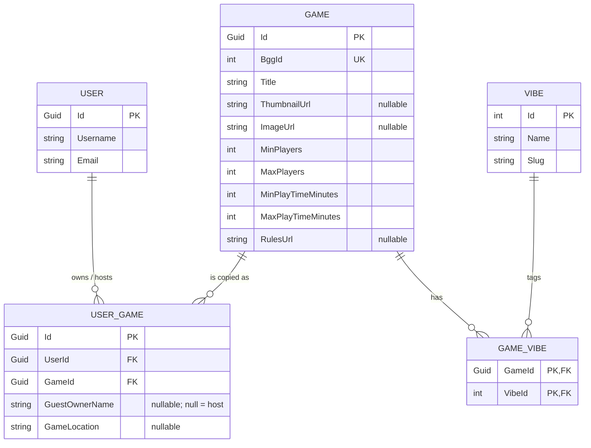
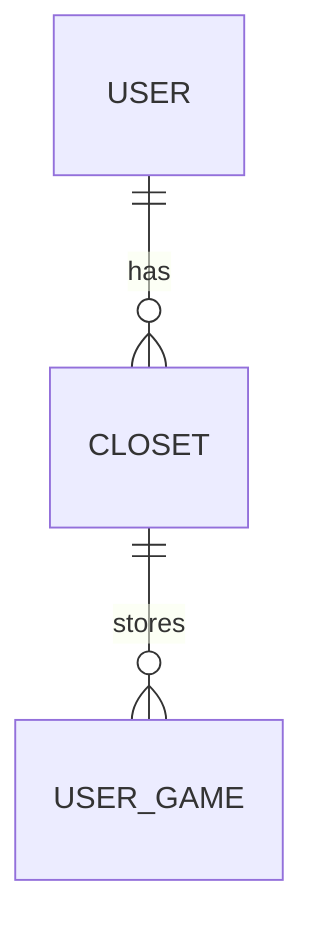

# Geen Gezever Constitution

Geen Gezever is a mobile-first companion app that picks the right board game for the people in the
room in **under 60 seconds**. It works with the games physically present tonight, including copies
brought by visiting friends, and surfaces them through a quick multi-parameter Match Finder or a
Tinder-style swipe deck. The `.context/` documents (00–04) are the detailed reference. This
constitution is the binding contract derived from them.

## Core Principles

### I. Layered Architecture & Dependency Boundaries (NON-NEGOTIABLE)

The solution is a 3-tier layered architecture with a separate client and a shared contracts
project. Dependencies flow inward toward Core. Api and Client meet only through Contracts.

| Layer | Project | Responsibilities | Allowed references |
| --- | --- | --- | --- |
| Core | `Geen_Gezever.Core` (assembly `Geen_Gezever`) | Entities, value objects, domain logic, service interfaces, repository interfaces | None |
| Contracts | `Geen_Gezever.Contracts` | DTOs (request and response shapes) shared by Api and Client | None |
| Infrastructure | `Geen_Gezever.Infrastructure` | EF Core `DbContext`, migrations, repository implementations, BGG XML API client | Core |
| API | `Geen_Gezever.Api` | Controllers/minimal APIs, routing, mapping between entities and DTOs, request validation, DI setup, OpenAPI | Core, Infrastructure, Contracts |
| Client | `Geen_Gezever.Client` | Blazor WASM PWA pages, components, state containers, HTTP calls to the API | Contracts |

- Core MUST have zero dependencies on external frameworks, databases, ORMs, or API/UI packages.
  Core MUST NOT reference Contracts, Infrastructure, Api or Client.
- Contracts MUST contain only DTOs: plain data shapes with no domain logic and no persistence
  concerns. Contracts MUST NOT reference any other project.
- Mapping between Core entities and Contracts DTOs MUST happen in the Api.
- EF Core types (`DbContext`, `DbSet`, migrations, EF attributes or fluent configuration) MUST
  live in Infrastructure only.
- All database access MUST go through repository interfaces or dedicated domain query handlers
  defined in Core and implemented in Infrastructure.
- The Client MUST NOT receive a `DbContext`, `IQueryable`, or a raw persistence entity. Data
  crosses the API boundary only as typed DTOs defined in Contracts.
- The Client MUST talk to the backend only over HTTP. It MUST NOT reference Core, Infrastructure or
  Api.

**Rationale**: strict boundaries keep the matching logic framework-free and unit-testable. They also
allow the database to switch from SQLite to PostgreSQL without touching the domain or the UI.

### II. ERD Fidelity & Data Integrity

- The entities, keys and relationships in **Domain Model & Data Constraints** are authoritative.
  Any schema change MUST first amend this constitution, then ship as an EF Core migration.
- `Game.BggId` MUST be unique. A BGG title exists once in the `Game` catalog.
- `UserGame` MUST keep its own Guid `Id`, so one user can hold the same game more than once, for
  example the host's copy and a guest's copy.
- `UserGame.GuestOwnerName` is the only source of ownership: `null` means host-owned, and a
  non-null value names the visiting friend who brought that copy.
- `GameVibe` MUST use the composite primary key `(GameId, VibeId)`.

**Rationale**: the recommendation engine is only as correct as the ownership and metadata it reads.

### III. Room-First Selection

- Recommendations MUST only include `UserGame` copies from sources the host has marked active for
  the current game session. Sources are the host's own shelf and each guest owner.
- A game that is not physically present tonight MUST never be recommended, however well it scores.

**Rationale**: suggesting a game nobody brought wastes the time the app exists to save.

### IV. Strict Player Count, Soft Ranking

- The player count is a hard filter. It is never relaxed: not in the fallback, not in swipe mode,
  not in any future mode.
- Duration and vibe only influence ranking and scoring. They MUST NOT exclude a game on their own,
  except through the bounded result sets defined in **Matching Engine Specification**.

**Rationale**: a game that does not support the group size cannot be played, while a game that
runs slightly long or short often still can.

### V. Decisive, Not Endless

- The Match Finder MUST present a prominent Top 3 and MUST NOT present an unbounded list.
- The flow from opening the app to a chosen game MUST be achievable in under 60 seconds.
- An empty result MUST trigger the Smart Time Stretch fallback before the UI shows "no match".

**Rationale**: choice paralysis is the problem being solved, so more options is not a feature.

### VI. Frictionless Onboarding via BoardGameGeek

- Adding a game MUST work through BGG search and a single tap to link it. Users MUST NOT have to
  enter metadata by hand (players, play time, images).
- BGG XML API 2 calls MUST go through `IHttpClientFactory` with Polly resilience (exponential
  backoff and retry) and MUST respect BGG rate limits.
- Metadata MUST be cached in the local `Game` catalog. A BggId already present MUST NOT be fetched
  again for every user who adds it.

**Rationale**: shelf management is admin overhead, so it has to be close to invisible.

### VII. Mobile-First, Accessible & Table-Respectful UI

- Every screen MUST be designed for one-handed phone use first, in dim, cozy lighting.
- Interactive targets MUST be at least 48×48 px (WCAG 2.5.5).
- The UI MUST meet WCAG 2.1 AA: text contrast ≥ 4.5:1, and graphical or card elements ≥ 3:1.
- Swipe gestures MUST animate smoothly at 60 fps, using lightweight JS interop
  (`touchstart`/`touchmove`/`touchend`) or CSS touch actions.
- The app MUST NOT add engagement mechanics (notifications, feeds, timers) that keep the phone on
  the table once a game has been chosen.

**Rationale**: the app is a quick decision tool. Once the game is picked, the phone goes away.

### VIII. Senior Mindset — No Assumptions, No Unilateral Decisions

This applies to everyone who contributes: AI assistants and human developers alike.

- Contributors MUST approach every task as a senior developer would: challenge unclear
  requirements, flag risks, trade-offs and inconsistencies, and think through edge cases before
  writing code.
- Contributors MUST NOT make assumptions. Anything that does not follow directly from this
  constitution or the `.context/` documents MUST be turned into an explicit question to the
  product owner.
- Contributors MUST NOT make a decision on their own when that decision is not already recorded in
  this constitution or `.context/`. This covers, among other things, naming, libraries and
  dependencies, schema changes, UX flows, scoring rules and API contracts. Contributors MUST present
  the options, each with its trade-offs and a recommendation, and wait for approval.
- Trivial, purely local implementation details that have no effect on behaviour, contracts or
  structure are exempt. Examples are formatting and the names of local variables.
- Once a question has been answered, the answer MUST be recorded in the relevant artifact (spec,
  plan, `.context/` or this constitution). Otherwise the same question comes back later.

**Rationale**: silent assumptions cause rework and misaligned features. Asking first keeps the
product owner and the implementer on the same page.

## Domain Model & Data Constraints

### Entities

| Entity | Field | Type | Notes |
| --- | --- | --- | --- |
| **User** | `Id` | Guid | PK |
| | `Username` | string | |
| | `Email` | string | |
| **Game** | `Id` | Guid | PK |
| | `BggId` | int | Unique index |
| | `Title` | string | |
| | `ThumbnailUrl` | string? | Not every BGG item has an image |
| | `ImageUrl` | string? | Not every BGG item has an image |
| | `MinPlayers` | int | Used by the hard filter |
| | `MaxPlayers` | int | Used by the hard filter |
| | `MinPlayTimeMinutes` | int | Used by the duration soft filter |
| | `MaxPlayTimeMinutes` | int | Used by the duration soft filter |
| | `RulesUrl` | string? | Not supplied by the BGG XML API, so often empty |
| **UserGame** | `Id` | Guid | PK. Allows duplicate copies of a game per user |
| | `UserId` | Guid | FK → User |
| | `GameId` | Guid | FK → Game |
| | `GuestOwnerName` | string? | `null` = host-owned, otherwise the guest's name |
| | `GameLocation` | string? | Free-text shelf/spot. Replaced by `ClosetId` in Sprint 2 |
| **Vibe** | `Id` | int | PK |
| | `Name` | string | |
| | `Slug` | string | URL-safe identifier |
| **GameVibe** | `GameId` | Guid | Composite PK part, FK → Game |
| | `VibeId` | int | Composite PK part, FK → Vibe |

### Entity Relationship Diagram

## Matching Engine Specification

The matching rules are domain logic and MUST be implemented in Core. They MUST be covered by unit
tests for each rule below.

1. **Candidate set**: the `UserGame` copies from the active sources of the current session
   (Principle III).
2. **Hard filter (player count)**: keep a game only when
   `MinPlayers <= RequestedPlayers AND MaxPlayers >= RequestedPlayers`. A game that does not
   support the exact requested player count is excluded, with no exceptions.
3. **Exact duration match**: a game matches when
   `MinPlayTimeMinutes <= RequestedDuration AND MaxPlayTimeMinutes >= RequestedDuration`.
4. **Ranking**: the matching games are ordered by:
   1. **Vibe match** (primary): the number of requested vibes that the game has as `GameVibe` tags.
      More overlap ranks higher.
   2. **Duration proximity** (tiebreaker only): the distance between `RequestedDuration` and the
      midpoint of the game's range, `(MinPlayTimeMinutes + MaxPlayTimeMinutes) / 2`. A smaller
      distance ranks higher.

   **Rationale**: if a game is fun, the exact duration matters less.
5. **Output**: the Top 3 highest-ranked games (Principle V).
6. **Empty match fallback (Smart Time Stretch)**: when zero games match the requested duration
   exactly, return instead:
   - at most **2 shorter** games:
     `RequestedDuration - 15 <= MaxPlayTimeMinutes < RequestedDuration`, and
   - at most **1 longer** game:
     `RequestedDuration < MinPlayTimeMinutes <= RequestedDuration + 15`.

   Within each group, games are ordered by the ranking in rule 4. The player-count hard filter
   stays strictly enforced during the fallback.
7. **Tinder swipe mode**: the deck combines the exact duration matches (rule 3) with all shorter
   and longer games inside the 15-minute bounds of rule 6, so there is enough variety to swipe
   through. The hard filter and the active-source rule still apply to every card.

## Technology Stack & Quality Standards

- **Runtime**: .NET 10 (`net10.0`) and C# for all projects.
- **API**: RESTful ASP.NET Core Web API with typed DTO contracts, request validation and
  OpenAPI documentation.
- **Persistence**: Entity Framework Core. SQLite for local development, PostgreSQL as the
  production target. Code MUST NOT rely on provider-specific behaviour that breaks either one.
- **External integration**: BGG XML API 2 via `IHttpClientFactory` + Polly (Principle VI).
- **Frontend**: Blazor WebAssembly as an installable PWA, with a service worker for asset caching
  and standalone launch from the iOS/Android home screen.
- **Client state**: scoped C# state container services injected into components.
- **Session state**: the active source selection of a game session lives client-side only, in a
  state container persisted to `localStorage`. There is no server-side `Session` entity. Adding
  server-side persistence later is easier than removing it.
- **Styling**: Tailwind CSS, utility-first.
- **Tooling**: Visual Studio Code with the C# Dev Kit, and Git with a feature-branch workflow.

## Development Workflow & Quality Gates

- Every feature follows the Spec Kit flow: `/speckit-specify` → `/speckit-clarify` (when needed)
  → `/speckit-plan` → `/speckit-tasks` → `/speckit-implement`.
- Every `plan.md` MUST pass a Constitution Check against Principles I–VIII before design starts,
  and again after design. Any justified deviation MUST be recorded in the plan's Complexity
  Tracking table.
- Work happens on feature branches. Merging requires the solution to build and all tests to pass.
- Matching engine changes MUST come with unit tests in Core. Schema changes MUST come with an EF
  Core migration that applies cleanly to SQLite.
- AI assistants MUST read `.context/` and this constitution before generating code, and MUST
  respect the layer boundaries and ERD without exception.

## Roadmap: Sprint 2 — Multi-Closet System

This is a planned direction and not yet binding schema. It becomes binding through a MINOR
amendment of this constitution when Sprint 2 is specified.

- Introduce a **Closet** entity: `Id` (Guid), `UserId` (Guid, FK → User), `Name` (string, for
  example "Living Room Kallax" or "Basement"), `Description` (string?).
- Relate **User 1-to-many Closet**.
- Migrate `UserGame.GameLocation` from a free-text string to a foreign key `UserGame.ClosetId`
  (FK → Closet), plus an optional free-text slot/shelf detail string.
- The migration MUST preserve existing `GameLocation` data, for example by seeding closets from
  distinct values or by moving the text into the slot/shelf detail field.

## Governance

- This constitution overrides all other project practices. The `.context/` documents are
  explanatory references. When they conflict with this constitution, this constitution wins
  until it is amended.
- **Amendments** MUST be made through `/speckit-constitution`. Each amendment MUST include a Sync
  Impact Report, update the version and Last Amended date, and update `.context/` when those
  documents are affected.
- **Versioning** follows semantic versioning:
  - MAJOR: removing or redefining a principle, or making a backward-incompatible governance change.
  - MINOR: adding a principle or section, materially expanding guidance, or adding a schema entity.
  - PATCH: clarifications, wording and typo fixes.
- **Compliance**: every plan and code review MUST check layer boundaries, ERD fidelity and the
  matching rules. Additional complexity MUST be justified in writing.
- `.context/CLAUDE.md` holds the runtime guidance for AI assistants.

**Version**: 2.0.0 | **Ratified**: 2026-09-29 | **Last Amended**: 2026-10-10
